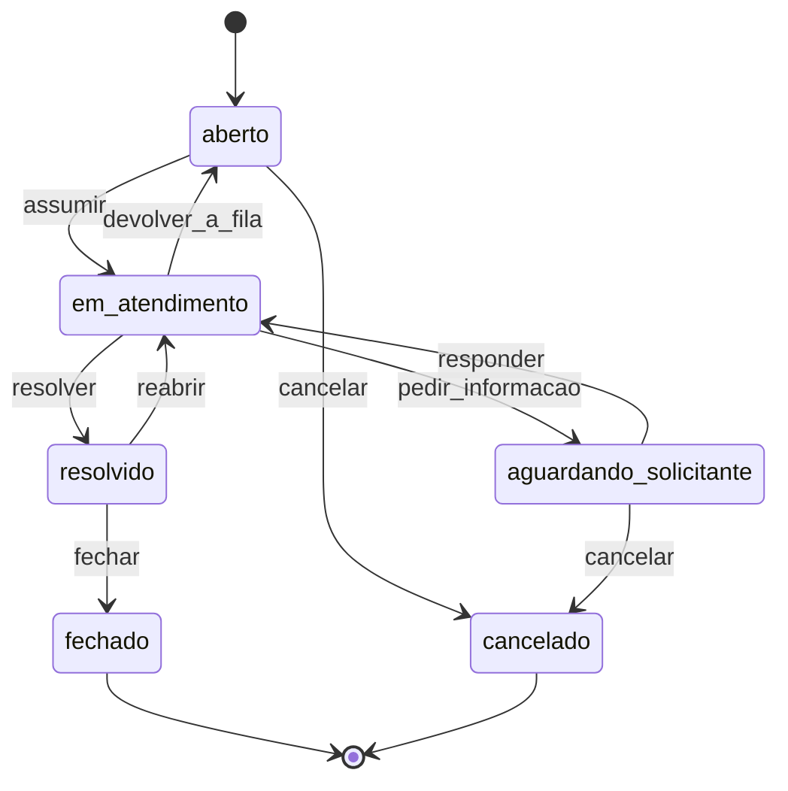

# Helpdesk com máquina de estados

[](https://github.com/Canhao43/helpdesk-maquina-de-estados/actions/workflows/ci.yml)

API em Laravel de um helpdesk interno: quem tem um problema abre um chamado, quem atende trabalha a fila. O centro do projeto é a **máquina de estados** do chamado. Cada mudança de situação é uma transição com regra própria de quem pode fazer, e uma transição proibida nunca chega ao banco.

É um problema genérico, escrito do zero, e todo dado é fictício.

> Construído com agentes de IA (Claude Code) e revisado por mim em cada PR. As regras que os agentes seguem estão em [`CLAUDE.md`](CLAUDE.md).

## Roteiro

| Marco | O que entra | Estado |
|---|---|---|
| **M1** | Login por token, papéis (solicitante, atendente, admin), abrir e consultar chamados | ✅ |
| **M2** | Máquina de estados: transição inválida = `422`, sem permissão = `403`, dois atendentes ao mesmo tempo = `409` | 🟡 em revisão |
| **M3** | Histórico imutável de cada transição; tokens com escopo | — |
| **M4** | SLA por prioridade, com o relógio parado enquanto se espera o solicitante | — |
| **M5** | Registro de decisões e README final | — |

## Como rodar

Precisa de PHP 8.4 e Composer.

```bash
git clone https://github.com/Canhao43/helpdesk-maquina-de-estados.git
cd helpdesk-maquina-de-estados
composer install
cp .env.example .env && php artisan key:generate
touch database/database.sqlite
php artisan migrate --seed
php artisan serve
```

O `--seed` cria três usuários de demonstração, um por papel, todos com a senha `password`: `solicitante@exemplo.test`, `atendente@exemplo.test` e `admin@exemplo.test`. Em produção o seeder se recusa a rodar.

Testes: `php artisan test`.

## A API

| Método e caminho | Quem | O que faz |
|---|---|---|
| `POST /api/tokens` | qualquer um | Troca e-mail e senha por um token (`Bearer`) que vale 7 dias. Cinco tentativas por minuto por e-mail e IP |
| `DELETE /api/tokens/atual` | logado | Revoga o token usado na requisição |
| `GET /api/eu` | logado | Quem é o dono do token, com o papel |
| `POST /api/chamados` | logado | Abre um chamado. Responde `201` com `Location` |
| `GET /api/chamados` | logado | Lista paginada. O solicitante vê só os próprios; atendente e admin veem todos |
| `GET /api/chamados/{id}` | dono, atendente ou admin | Um chamado, com a `versao` e as `acoes_disponiveis` para quem pergunta. O de outra pessoa responde `404`, igual a um inexistente |
| `POST /api/chamados/{id}/acoes/{acao}` | depende da ação (abaixo) | Executa uma transição e devolve o chamado atualizado |

## A máquina de estados



| Ação | Quem pode |
|---|---|
| `assumir` | atendente ou admin. Quem assume vira o atendente do chamado |
| `devolver_a_fila`, `pedir_informacao`, `resolver` | o atendente do chamado, ou admin |
| `responder`, `reabrir`, `fechar` | o solicitante, porque quem confirma que o problema acabou é quem tinha o problema |
| `cancelar` | o solicitante ou admin, antes de alguém estar trabalhando no chamado |

A tabela de transições mora num lugar só (`App\Enums\Acao`), e quem pode cada ação mora na policy. Toda mudança de estado passa pela `MaquinaDeEstados`, e o `estado` não está no `fillable`.

**As respostas, nesta ordem:**

1. **`404`** se o usuário não vê o chamado. Vem antes de tudo: um `403` ou um `422` confirmaria que o chamado existe.
2. **`422`** se a ação não vale no estado atual. A resposta traz o estado e as `acoes_permitidas`, ou seja, o que esse usuário pode fazer agora.
3. **`403`** se a ação vale no estado, mas não é desse usuário.
4. **`409`** se o chamado mudou entre a leitura e a gravação. A gravação só acontece se a `versao` no banco ainda for a lida.

```bash
TOKEN=$(curl -s -X POST localhost:8000/api/tokens -H 'Content-Type: application/json' \
  -d '{"email":"solicitante@exemplo.test","senha":"password"}' | jq -r .token)

curl -s -X POST localhost:8000/api/chamados -H "Authorization: Bearer $TOKEN" \
  -H 'Content-Type: application/json' -H 'Accept: application/json' \
  -d '{"titulo":"Impressora não imprime","descricao":"A fila trava no primeiro documento."}'
```

## Decisões até aqui

| Decisão | Por quê | Descartado |
|---|---|---|
| **Chamado alheio responde `404`, não `403`** | Com `403`, quem testasse ids em sequência saberia quais existem. Todo `404` da API sai com o mesmo corpo, porque a mensagem padrão do Laravel diria o nome do model num caso e não no outro | `403`, que é "mais correto" e vaza a existência |
| **Quem vê o quê na listagem é filtrado na consulta** (escopo `visiveisPara`) | Filtrar depois de buscar quebraria a paginação, e o total contaria chamados escondidos | Policy item a item na coleção |
| **O dono do chamado é sempre o dono do token** | `solicitante_id`, `atendente_id` e `estado` ficam fora do `fillable`. Mandar esses campos no corpo não muda nada, e há teste disso | Confiar no corpo e validar depois |
| **`papel` fora do `fillable` do usuário** | Nenhum dado vindo de requisição promove alguém a atendente ou admin | — |
| **Token do Sanctum com validade de 7 dias** | Token sem validade é credencial eterna se vazar | Sem validade (o padrão do Sanctum) |
| **Login: mesma resposta e mesmo tempo para e-mail inexistente e senha errada** | Quem tenta não descobre quais e-mails têm conta. Sem conta, o hash não roda e a falha voltaria mais rápido: o relógio entregaria o que a mensagem esconde. A falha leva no mínimo 200 ms (`Timebox`, como no login de sessão do Laravel) | Mensagens diferentes, mais "amigáveis" · comparar com um hash falso, que amarra o tempo ao custo do bcrypt configurado |
| **Limite de login por e-mail + IP** | Trava a força bruta de um IP contra uma conta, e o atacante não bloqueia o login da vítima, que vem de outro IP | Só por IP (bloqueia um escritório inteiro) · só por e-mail (o atacante tranca a vítima) |
| **SQLite, mantido no M2**, com espera de 5 s quando o banco está travado | A proteção contra corrida é a gravação condicional, que funciona igual em qualquer banco. O SQLite serializa as escritas, e o `busy_timeout` faz quem chega depois esperar em vez de falhar. O CI prova com 10 requisições ao mesmo tempo | MySQL, que pediria servidor ou Docker para provar o mesmo |
| **Máquina de estados escrita à mão**: uma tabela no enum `Acao`, a permissão na policy | São 6 estados e 8 ações. A tabela inteira cabe numa tela e tem teste próprio: estado final sem saída, nenhum beco sem saída, todo estado alcançável | Pacote de máquina de estados (`spatie/laravel-model-states`), uma dependência para um problema pequeno |
| **Ação como recurso: `POST /chamados/{id}/acoes/{acao}`** | Cada transição tem nome, regra e resposta próprias. Um `PATCH` com `{"estado": "resolvido"}` deixaria o cliente escolher o destino, e a API teria de descobrir que ação ele quis dizer | `PATCH` no campo `estado` |
| **Ordem: `404` → `422` → `403` → `409`** | O `404` primeiro não vaza a existência. O estado antes da permissão dá a resposta mais útil: o atendente que tenta resolver um chamado ainda aberto recebe "assuma primeiro", e não "não é seu" | Permissão antes do estado: correto, mas o `403` esconderia o motivo real |
| **Gravação condicional à `versao`, não ao `estado`** | O chamado pode sair do estado lido e voltar a ele com outro atendente: em atendimento com a Ana, devolvido, assumido pela Bia. O estado bate; a versão, não. Há teste desse caso | `WHERE estado = <lido>`, que deixaria a Ana resolver o chamado da Bia · trava pessimista (`SELECT ... FOR UPDATE`), que o SQLite não tem |
| **`acoes_disponiveis` na resposta** | O cliente não reimplementa a máquina de estados para saber que botões mostrar | O cliente deduzir pelo estado e pelo papel |

**Limites conhecidos:** o limite de login não segura ataque distribuído por muitos IPs. Token vencido continua na tabela até alguém rodar `php artisan sanctum:prune-expired`. A proteção do `409` cobre a corrida dentro do servidor. Ainda não há `If-Match`: um cliente que decidiu olhando uma tela de dez minutos atrás não é avisado, se a ação ainda valer.
